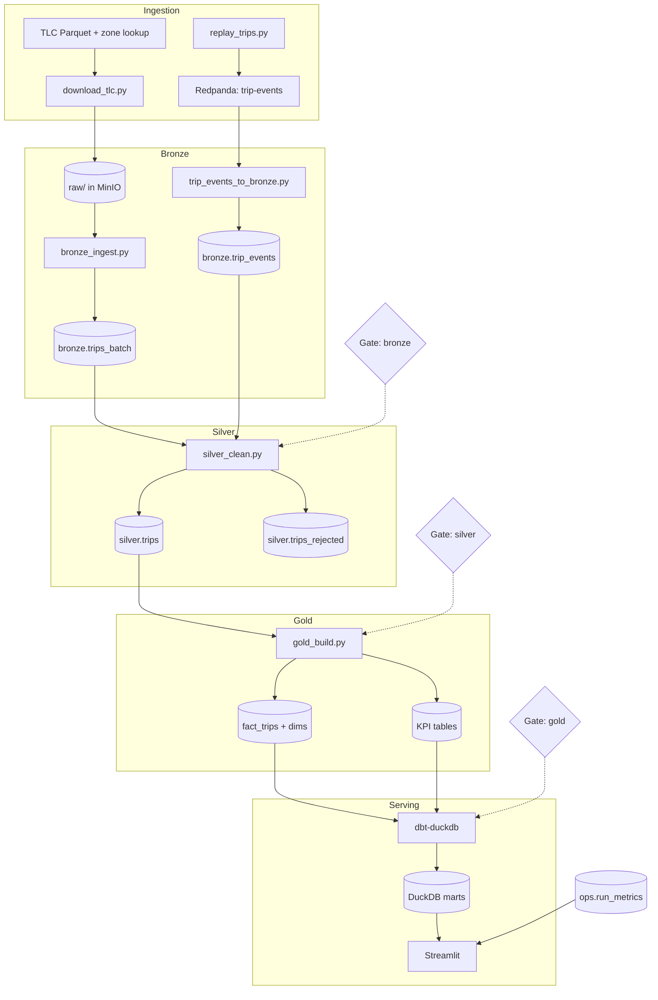
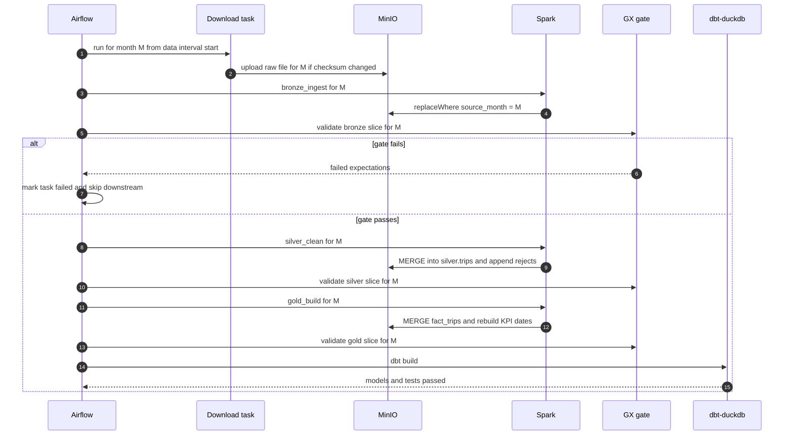
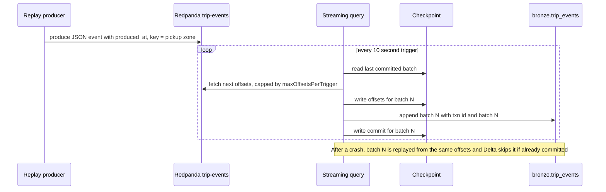
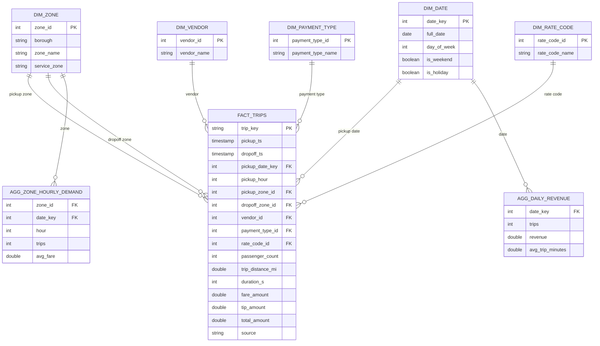
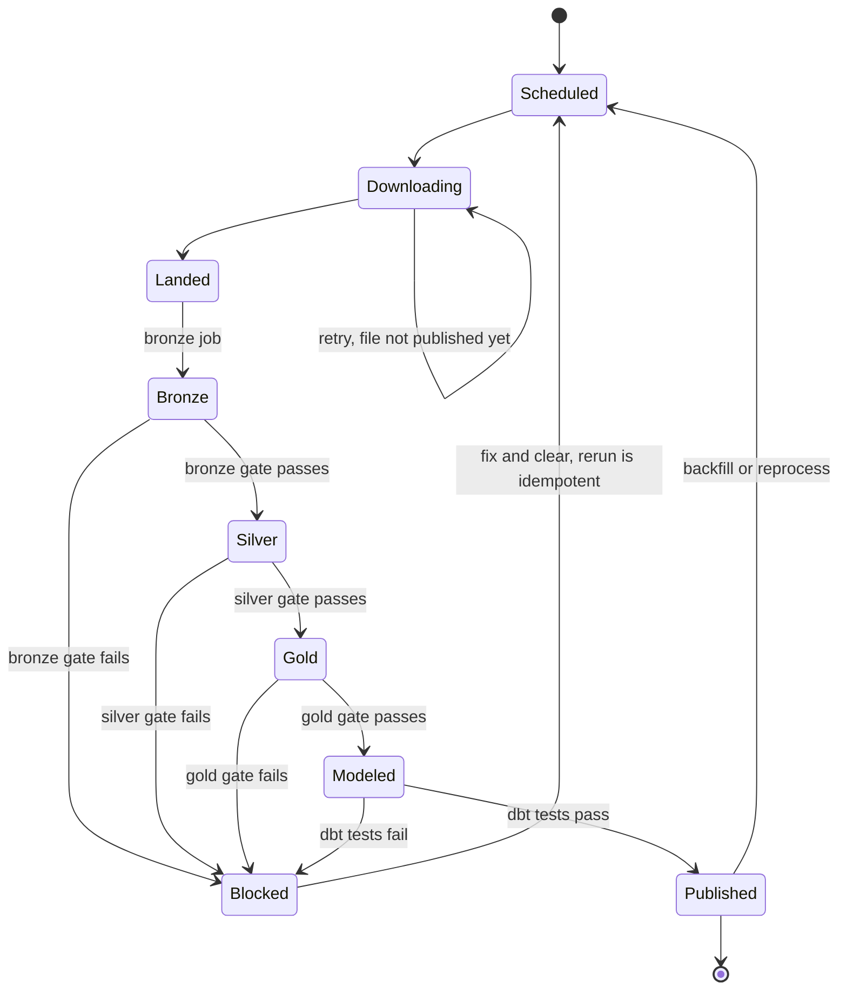
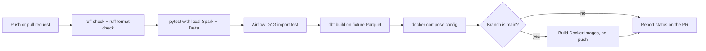
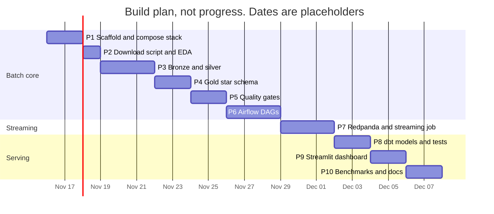

# Rapture – interview prep

Companion to the README. Everything here describes the design and the plan. No results exist yet: wherever a number belongs, it stays a placeholder until a real run fills it in `docs/results/`.

## At a glance

### 30-second pitch

I built a lakehouse on the public NYC taxi trip data that runs entirely on my laptop. Trips come in two ways: monthly Parquet files through a batch path, and replayed trip events through Redpanda and Spark Structured Streaming. Spark cleans them through bronze, silver and gold Delta tables with idempotent `MERGE` writes, Great Expectations gates stop bad data between layers, Airflow schedules and backfills the batch, and dbt on DuckDB serves tested marts to a small dashboard.

### 2-minute walkthrough

"The data is the NYC TLC yellow taxi trip records. Every month is a Parquet file with a few million rows, and it is messy: negative fares, dropoffs before pickups, rows dated years outside the month, and no trip ID.

Ingestion has two paths. A download script puts the monthly files and the zone lookup into MinIO, which is an S3-compatible store, so all my Spark code uses the same `s3a` paths it would use on AWS. For streaming, a Python producer replays trips as JSON events into Redpanda, which speaks the Kafka API. A Structured Streaming job reads the topic every 10 seconds and appends to a Delta bronze table. The checkpoint plus Delta's transaction log mean a crash does not duplicate a micro-batch.

Bronze is raw data plus metadata. I keep the batch and stream bronze tables separate because two Spark drivers writing one Delta table on S3-style storage is not safe without an external lock. Silver is where I do the real work: one schema, a deterministic `trip_key` hash since TLC has no ID, dedup, and rule-based rejection into a quarantine table with reason codes. Gold is a star schema with a trip-grain fact table and KPI tables.

Between every layer a Great Expectations suite runs. If it fails, the Airflow task fails and the month stops there. Airflow runs one month per DAG run, which makes backfills just a date range. On top of gold, dbt-duckdb builds marts with tests, and a Streamlit app shows trip KPIs and pipeline health. Each job logs rows and runtime to a metrics table, which is where my numbers come from: [rows per run], [runtime per layer], [events/sec], [p95 latency to bronze], and [rejected percentage]."

## Tech stack deep dive

| Tool | What it does here | Why this and not the alternative |
|---|---|---|
| Python 3.11 | Download script, producer, Spark jobs, GX gates, dashboard | One language end to end. Not Scala: PySpark covers everything needed and is what most DE teams use |
| PySpark 3.5 | Bronze, silver, gold and streaming jobs | Not pandas or Polars: Polars would handle 3 months on a laptop, but Spark has the same API for batch and streaming and scales past one machine |
| Delta Lake 3.x | Table format for every layer | Not Apache Iceberg: Iceberg has broader multi-engine support, but Delta has the simplest Spark setup with no catalog service and a built-in idempotent streaming sink |
| Redpanda | Kafka-API broker for trip events | Not Apache Kafka: same wire protocol, but a single container with no JVM and lower memory. Producer and Spark code work unchanged on Kafka or Amazon MSK |
| Spark Structured Streaming | Topic to `bronze.trip_events`, and bronze to silver incrementally | Not Flink: Flink is better for low-latency stateful jobs, but reusing Spark and the Delta sink keeps one engine and one skill set |
| MinIO | S3-compatible object store for raw files and Delta tables | Not the local filesystem: exercises the real `s3a` configuration and S3 semantics, including the Delta multi-writer limitation |
| Apache Airflow | Monthly batch DAG, hourly stream-to-silver DAG, retries, backfills | Not Dagster or Prefect: Dagster's asset model fits lakehouses well, but Airflow is what most job postings and existing teams use |
| Great Expectations (GX Core) | Validation suites on Spark DataFrames between layers | Not dbt tests alone: dbt only sees tables it models, and the gates must run between Spark layers before data is promoted. Not Soda: GX has more examples and a Spark data source |
| dbt + DuckDB | Staging and mart models on gold, tests, docs | Not dbt-spark or Snowflake: DuckDB is in-process and free and reads Delta directly. Snowflake is a stretch goal with the same models |
| Streamlit | Trip KPI and pipeline health dashboard | Not Superset: Superset needs its own metadata DB and services. Streamlit is one Python file |
| Docker Compose | Runs the whole stack with profiles (`core`, `batch`, `stream`) | Not Kubernetes or kind: one machine, one command. Profiles keep memory use down |
| GitHub Actions | Lint, tests, DAG import, dbt build, image build | Not Jenkins: hosted and free for public repos, no server to run |

### Concepts you must know

**PySpark**
- Lazy evaluation: transformations build a plan, actions (`count`, `write`) run it.
- Narrow vs wide transformations. Wide ones (`groupBy`, `join`, `dropDuplicates`) cause a shuffle.
- `spark.sql.shuffle.partitions` (default 200) and Adaptive Query Execution, which coalesces small shuffle partitions and splits skewed ones.
- Broadcast joins for small dimensions such as the 265-row zone lookup.
- Partitioning on write (`partitionBy`) vs in-memory partitions (`repartition`, `coalesce`).
- Reading the Spark UI: stages, tasks, shuffle read and write, spill, skew.
- Session time zone: TLC timestamps are NYC local wall-clock with no zone, so the session runs in UTC to avoid silent shifts.

**Delta Lake**
- The `_delta_log` folder: ordered JSON commits plus Parquet checkpoints every 10 commits. A table version is the set of files listed by the log.
- Optimistic concurrency: writers read a version, write files, then try to commit the next version. Conflicts are detected at commit.
- On S3-style storage the default LogStore is safe for one driver only. Multi-driver writes need the DynamoDB LogStore.
- `MERGE INTO` for upserts. Each target row may match at most one source row.
- `replaceWhere` to overwrite only matching partitions.
- Schema enforcement (rejects mismatched writes) vs schema evolution (`mergeSchema`).
- Time travel (`versionAsOf`, `timestampAsOf`), `DESCRIBE HISTORY`, `RESTORE`.
- `OPTIMIZE` (compaction), Z-ordering, `VACUUM` (default 7-day retention).
- Data skipping from per-file min and max stats.

**Redpanda / Kafka API**
- Topics, partitions, offsets. Ordering is guaranteed only within a partition.
- Message key decides the partition. Here the key is the pickup zone ID.
- Retention: a topic is a replayable log, not a queue.
- Producer `acks`, retries and idempotence. Without idempotence, a retry can write a duplicate.
- Consumer lag. Spark does not commit offsets to a consumer group by default. It tracks them in its own checkpoint.

**Spark Structured Streaming**
- Micro-batch model, triggers (`processingTime`, `availableNow`).
- Checkpoint contents: offsets log (planned batch), commits log (finished batch), state store, metadata with the query ID.
- End-to-end exactly-once needs a replayable source, a checkpoint, and an idempotent sink. The Delta sink stores `(queryId, batchId)` in its log and skips a batch it has already committed.
- `maxOffsetsPerTrigger` for rate limiting.
- Watermarks bound state for aggregations and stream dedup. The bronze job is a stateless append, so it does not need one.
- `StreamingQueryProgress` metrics: `inputRowsPerSecond`, `processedRowsPerSecond`, batch duration.

**MinIO**
- S3 API: buckets, objects, no real directories, no atomic rename.
- `s3a` settings: endpoint, path-style access, access and secret keys from env.
- Why "rename to commit" patterns are slow or unsafe on object stores, and why Delta avoids them.

**Airflow**
- DAG, task, operator, TaskFlow API, XCom (small metadata only).
- Data interval and logical date. A monthly run for January starts after January ends.
- `catchup`, backfill command (`airflow backfill create` in Airflow 3, `airflow dags backfill` in 2.x).
- Retries, `retry_delay`, `execution_timeout`, trigger rules, task failure callbacks.
- Idempotent tasks: same input interval, same output, no matter how many times it runs.
- Executor choice: LocalExecutor with Postgres here.

**dbt**
- `source()` and `ref()` build the lineage graph.
- Materializations: view, table, incremental, ephemeral.
- Generic tests (`unique`, `not_null`, `relationships`, `accepted_values`) and singular SQL tests.
- `dbt build` runs models and tests in DAG order and stops dependents on failure.
- `dbt docs generate` for lineage and column docs. Snapshots for SCD2 (stretch).

**DuckDB**
- In-process columnar SQL engine. One file, no server.
- `httpfs` extension and secrets for S3 endpoints, `delta` extension with `delta_scan`.
- Single writer per database file. Readers like the dashboard open it read-only.

**Great Expectations**
- Expectation, expectation suite, batch definition on a Spark DataFrame, validation definition, checkpoint, validation result.
- Table-level expectations (row count, column set) vs column-level (not null, unique, between, in set).
- A gate is a validation whose failure raises and stops the pipeline.

**Docker Compose and GitHub Actions**
- Services, networks, named volumes, health checks, `depends_on` with `condition: service_healthy`.
- Profiles to start only part of the stack.
- Actions: workflows, jobs, steps, caching dependencies, `setup-java` for Spark tests, matrix builds.

## Charts and workflows

### System flowchart

Every box with a cylinder is a Delta table in MinIO except the DuckDB marts. Gates sit in front of the job that would promote data to the next layer.

### Monthly batch run

One DAG run processes one month. The silver and gold gates fail the same way as the bronze gate, which is left out to keep the diagram readable.

### Streaming micro-batch

This is why the bronze stream table is exactly-once even though the producer side is at-least-once. Producer duplicates are removed later by the silver `trip_key` dedup.

### Gold data model

Star schema at one-row-per-trip grain. `dim_zone` is used twice (pickup and dropoff), a role-playing dimension. `agg_tip_rate` follows the same pattern and is left out for space.

### Lifecycle of one month

Because every write is a partition overwrite or a `MERGE`, any state can go back to Scheduled and rerun without duplicating data.

### CI workflow

There is no deploy step because the project runs locally. The image build on `main` catches broken Dockerfiles early.

### Build plan

About 22 working days, which fits the 2 to 4 week target with slack for Docker and dependency issues.

## Interview questions with answers

### Project overview

**1. Walk me through the project in two minutes.**
Use the walkthrough above. Lead with the data problem (messy monthly files, no trip ID), then the two ingestion paths, the three layers with what each one guarantees, the gates, orchestration, and serving. Close with the metrics you measured, not with the tool list.

**2. Why the NYC TLC data?**
It is public, large enough that Spark is a reasonable choice (a few million rows per month), and it has real data quality problems: negative amounts, impossible durations, out-of-range dates, and schema drift across months. It also has a clean dimension source in the zone lookup, so a star schema is natural. Interviewers often know the dataset, which makes the discussion concrete.

**3. Why run everything locally instead of on AWS or Databricks?**
Cost and reproducibility. Anyone can clone the repo and run it with Docker and no account. MinIO speaks the S3 API, so the Spark code uses the same `s3a` paths and settings as on AWS. Terraform for a real S3 bucket is a stretch goal, and the only code change would be the endpoint and credentials.

**4. What does the medallion architecture give you here?**
Each layer has one clear contract. Bronze is a faithful copy plus metadata, so I can always rebuild downstream from it. Silver is one schema, deduplicated and valid, which is what analysts should query. Gold is shaped for questions (star schema and KPIs). The separation also makes debugging easier, because I can compare counts layer by layer and see where rows went.

**5. Why have a streaming path if the batch path already loads the same data?**
The TLC source is only published monthly, so the stream is a replay, and I say that openly. It exists to show the mechanics a real event source needs: offsets, checkpoints, an idempotent sink, backpressure, and latency measurement. It also shows how two ingestion paths converge in one silver table with one set of rules.

### Design decisions and trade-offs

**6. Why Delta Lake rather than plain Parquet?**
Plain Parquet has no transactions. A failed job can leave half-written files that readers pick up, and there is no `MERGE`, so dedup and upserts mean rewriting whole partitions by hand. Delta adds an atomic commit log, schema enforcement, `MERGE`, time travel to inspect a bad run, and a streaming sink that skips replayed batches. Iceberg would also work. I chose Delta for the simplest Spark setup.

**7. Why two bronze tables instead of one?**
The batch job and the streaming job are separate Spark drivers. On S3-compatible storage, Delta's default LogStore is only safe for writes from a single driver, because S3 lacks the put-if-absent guarantee the commit protocol needs. AWS setups solve this with the DynamoDB LogStore. Locally, giving each writer its own table is simpler and removes the risk, and silver reads both.

**8. TLC has no trip ID. How do you deduplicate?**
I build `trip_key` as a SHA-256 hash of vendor, pickup and dropoff timestamps, pickup and dropoff zones, distance, and total amount, after casting to fixed types and replacing nulls with a sentinel. `concat_ws` silently skips nulls, so without the sentinel two different rows could hash the same. The trade-off is that two genuinely different trips with identical values on all those fields would merge, which I accept and document.

**9. Why `MERGE` in silver instead of overwriting each month?**
Silver receives rows from two sources and from reruns, and a stream event for a month may arrive after the batch for that month has run. `MERGE` on `trip_key` makes every write an upsert, so order and repetition do not matter. Bronze can use `replaceWhere` because one month comes from exactly one file.

**10. Isn't it redundant to use Great Expectations and dbt tests?**
They guard different places. GX runs on Spark DataFrames between bronze, silver and gold, before data is promoted, and dbt cannot see those steps. dbt tests run on the marts, where the SQL models could introduce their own bugs such as a fan-out join. There is a little overlap on keys, which I accept because the cost is small.

**11. Why separate a rejected table instead of just dropping bad rows?**
Dropping rows hides problems. A rejected table with reason codes lets me measure the rejected percentage per month, alert on a spike, and replay rows if a rule turns out to be wrong. It also answers the analyst question "why is my count lower than the raw file".

**12. Why dbt on DuckDB instead of Spark SQL or Snowflake?**
Gold is small after aggregation, so an in-process engine is fast and free, and DuckDB reads Delta directly. dbt adds lineage, tests and docs on top of plain SQL. The models are standard enough that pointing them at Snowflake is a profile change, which is a stretch goal.

**13. Why does the gate task not retry, when Spark tasks do?**
Retries help with transient failures such as a container restart or a network blip. A failed expectation is deterministic: the same data gives the same result. Retrying it only delays the alert, so gates fail fast and a person looks at the validation result.

### Deep dives per tool

**14. How does Structured Streaming get exactly-once into Delta?**
Three parts. The Kafka source is replayable by offset. Before running batch N, the query writes the planned offsets to the checkpoint's offsets log. The Delta sink commits batch N with a transaction identifier of the query ID and batch ID. After a crash, Spark reruns batch N with the same offsets, and Delta sees that batch ID already committed and skips it.

**15. What is in a checkpoint, and what happens if you delete it?**
The offsets log, the commits log, query metadata including the query ID, and the state store for stateful queries. If you delete it, the query starts as new with a new ID and reads from `startingOffsets` (latest by default), so you either lose events or, with `earliest`, re-ingest everything. In bronze that would create duplicates that silver dedup then has to absorb. Checkpoints should be treated like part of the table.

**16. Do you need a watermark?**
Not in the bronze job, because it is a stateless append with no aggregation or stream dedup. A watermark matters when state must be bounded, for example `dropDuplicates` on a stream or a windowed count. If I did dedup in the stream I would use `withWatermark` on event time plus `dropDuplicatesWithinWatermark` in Spark 3.5. I chose to dedup in silver with `MERGE` instead, which needs no streaming state.

**17. How does the Delta transaction log work?**
Each commit writes a JSON file numbered with the next version, listing files added and removed and metadata changes. Every 10 commits a Parquet checkpoint summarizes the state so readers do not replay every JSON file. Readers build a snapshot from the latest checkpoint plus later JSON files. Writers use optimistic concurrency: they try to create the next version file, and if another writer got there first, they check for logical conflicts and retry or fail.

**18. What does `MERGE` cost, and how do you keep it fast?**
`MERGE` joins the source with the target, then rewrites every target file that contains a matched row. If the merge condition only has `trip_key`, Spark may scan the whole target. I add the partition column (`pickup_month`) to the condition so Delta prunes files, and I keep the source deduplicated so the merge does not fail on multiple matches. `OPTIMIZE` keeps file counts low.

**19. How did you choose partitioning?**
Silver and the fact table are partitioned by pickup month. A month is a few million rows, which gives reasonable file sizes. Partitioning by day would create about 30 times more small files with no real pruning benefit for these queries. Bronze is partitioned by `source_month`, the unit of rerun.

**20. Explain Airflow data intervals and how backfill works here.**
A run covers a data interval. For a monthly schedule, the run for January has an interval from January 1 to February 1 and starts after it ends. My tasks read `data_interval_start` to pick the month, never "now", so any run is reproducible. Backfill creates runs for past intervals: `airflow backfill create` in Airflow 3 or `airflow dags backfill` in 2.x, or `catchup=True` for the gap since `start_date`.

**21. How does Airflow run Spark here?**
The Airflow image has Java and pyspark installed, and tasks use `SparkSubmitOperator` against the standalone master in Compose. The driver runs in the Airflow worker container in client mode and executors run on the Spark worker. Task arguments pass only the month and config paths, never data through XCom.

**22. How are Kafka partitions and keys used?**
The topic has a few partitions and the producer keys each event by pickup zone, so events for one zone keep their order within a partition. Spark creates one input task per topic partition by default, so partition count sets read parallelism. Spark tracks offsets in its checkpoint instead of committing a consumer group, so tools that show consumer lag will not see it unless I export progress metrics.

**23. What makes a good Great Expectations suite for silver?**
Table-level checks: row count within a band of bronze minus rejects, exact column set. Column checks: `trip_key` unique and not null, timestamps not null, `trip_distance_mi` between 0 and 200, `payment_type_id` in the known set. A ratio check that the rejected percentage stays under a threshold, so a broken upstream file fails loudly instead of being silently filtered away.

**24. What does `dbt build` do that `dbt run` does not?**
`dbt build` runs models, tests, seeds and snapshots together in DAG order. If a test on a model fails, models downstream of it are skipped. `dbt run` only builds models, so a broken model could feed a mart before any test runs.

**25. Why does the dashboard open DuckDB read-only?**
DuckDB allows one writing process per database file. dbt writes the marts, so the dashboard opens the file in read-only mode and never holds a write lock. In production the serving layer would be a warehouse with concurrent readers, which is the Snowflake stretch goal.

### Scaling and failure modes

**26. What breaks first at 100 times the data?**
The single Spark worker and laptop memory, then `MERGE` cost on silver, since each merge rewrites matched files. I would move to a real cluster, merge only the affected partitions, run `OPTIMIZE` with Z-order on `trip_key` or pickup time, and consider liquid clustering. DuckDB would also stop being a sensible serving layer, so gold would go to a warehouse.

**27. The producer sends faster than Spark can process. What happens?**
Events pile up in Redpanda, which is fine since the topic is a durable log within its retention. Spark reads at most `maxOffsetsPerTrigger` per batch, so batch time stays bounded and latency grows instead of the job running out of memory. If lag keeps growing, I add topic partitions and executor cores, or lengthen the trigger interval for bigger, more efficient batches.

**28. How do you handle late-arriving data?**
Silver does not assume arrival order. A late stream event is merged on `trip_key` into the right month partition, and the hourly DAG refreshes gold KPI rows for the affected dates with `replaceWhere`. TLC also occasionally republishes a month. The download checksum detects the change and a rerun of that month replaces its bronze partition and merges the updates.

**29. A new TLC month adds a column or changes a type. What happens?**
Bronze reads each file with its own schema and adds metadata, so it lands. The silver mapping casts to a fixed schema and ignores unknown columns, and the bronze gate checks the expected column set and fails if a required column is missing. A new column only reaches silver when I add it to the schema on purpose, with `mergeSchema` on that write.

**30. MinIO goes down in the middle of a silver job. What state is the table in?**
The job fails before or after the commit. If the commit file was not written, the table is unchanged and the new data files are orphans that `VACUUM` removes later. If it was written, the merge is complete. There is no half state, which is the point of the log. Airflow retries the task and the `MERGE` is idempotent.

### Debugging scenarios

**31. The silver job is slow. What do you check?**
Spark UI first: which stage takes the time, shuffle read and write sizes, spill to disk, and task duration skew. Common causes here: `MERGE` scanning the whole target because the condition lacks the partition column, too many small files in the target, a skewed key such as a few airport zones, or 200 default shuffle partitions on small data. Then check the physical plan for a missing broadcast of the zone dimension.

**32. Streaming latency jumped from seconds to minutes.**
Compare batch duration to the trigger interval in the query progress. If batches take longer than the trigger, the query is falling behind: check input rows per batch, executor resources, and whether the bronze table has accumulated many small files. Also check that the producer clock and the Spark clock agree, since latency is measured across both, and that Redpanda itself is healthy.

**33. Gold row count for a month dropped 30 percent versus last month.**
Walk the layers with `ops.run_metrics`: raw file rows, bronze, silver, rejected, gold. If rejects spiked, look at the reason codes, since a schema change can make every row fail one rule. If silver is fine and gold dropped, check join keys to dimensions, for example new zone IDs missing from `dim_zone` turning an inner join into a filter. Delta time travel lets me diff the current version against the previous one.

**34. The silver `MERGE` fails with "multiple source rows matched".**
The source batch has two rows with the same `trip_key`, which can happen with exact duplicates in the TLC file or with a stream replay overlapping a batch month. The fix is to deduplicate the source inside the batch before the merge, keeping the latest `ingested_at` per key. I add a unit test with duplicate fixtures so it cannot regress.

**35. An Airflow task stays queued and never runs.**
Check that the scheduler and executor are healthy, then pool and parallelism limits, then `max_active_runs` on the DAG, since a large backfill can fill all slots. With LocalExecutor, a crashed scheduler container also leaves tasks queued. Logs from the scheduler container usually show the reason.

**36. The dbt `unique` test on `trip_key` fails in a mart.**
A unique key failing after gold usually means a fan-out join, for example joining to a dimension that has duplicate keys. I check the compiled SQL in `target/`, query the duplicated keys, and look at which join multiplied them. If gold itself has duplicates, the problem is upstream and the silver gate should have caught it, so I add that expectation too.

**37. A Spark executor runs out of memory.**
Look for a skewed shuffle partition or a collect to the driver first. Then check whether a broadcast join is broadcasting something large, whether AQE skew join handling is on, and executor memory versus the worker container's limit in Compose. On a laptop the usual fix is fewer cores per executor and more shuffle partitions, not just more memory.

### Behavioral

**38. Tell me about a hard technical problem on this project.** (STAR outline)
- Situation: concurrent writers or a failed merge, for example two jobs writing Delta tables on MinIO, or duplicates in a source batch.
- Task: keep reruns and restarts from corrupting or duplicating data.
- Action: explain the design change you actually made, such as splitting bronze tables, adding in-batch dedup, or adding the partition column to the merge condition.
- Result: [measured outcome, for example rerun of a month produced identical row counts, or merge time before and after].

**39. Tell me about a time you cut scope.** (STAR outline)
- Situation: the original design included Snowflake, Terraform on AWS, SCD2 snapshots and a Kafka cluster.
- Task: ship something complete and explainable in 2 to 4 weeks with no cloud budget.
- Action: kept the core path local (MinIO, Redpanda, DuckDB) and moved Snowflake, Terraform, SCD2 and data contracts to stretch goals.
- Result: [what shipped by when, and which stretch goal you added after].

**40. Tell me about a data quality issue you caught.** (STAR outline)
- Situation: an issue found in EDA or by a gate, for example rows dated outside the file's month or a type change between months.
- Task: stop it from reaching gold without silently losing data.
- Action: the rule or expectation you added, the reason code, and the test.
- Result: [measured rejected percentage for that rule, and what the gate caught on a later run].

## Trade-offs and what I'd change at 10x scale

**Trade-offs made on purpose**
- Local MinIO instead of S3: free and reproducible, but no real IAM, no lifecycle rules, and Delta's single-driver limit forced two bronze tables.
- Replayed stream instead of a live source: honest about the data, but traffic shape is synthetic and set by the producer rate.
- One small Spark cluster in Compose: realistic APIs, but performance numbers only compare within the same machine.
- DuckDB as serving layer: fast and free, single writer, not a multi-user warehouse.
- GX and dbt tests: some overlap in exchange for gates at every promotion.
- Month as the unit of work: simple backfills and reruns, but a single bad file blocks the whole month.

**At 10x scale**
- Real S3 with the DynamoDB LogStore, or a catalog such as Unity Catalog, so multiple writers can share tables safely.
- Managed Spark (EMR, Databricks or Glue) with autoscaling, and Kafka on MSK or Confluent Cloud.
- Merge only affected partitions, schedule `OPTIMIZE` and `VACUUM`, and evaluate liquid clustering.
- Daily instead of monthly processing units for faster recovery and smaller merges.
- Gold into Snowflake or another warehouse, with dbt incremental models.
- Data contracts on the event schema, enforced by a schema registry and checked in CI.
- Alerting on gate failures, rejected-percentage spikes and stream lag, not just failed tasks.

## Resume bullets

- Built a local lakehouse on NYC TLC trip data with PySpark, Delta Lake and MinIO, processing [measured metric: rows per month] through bronze, silver and gold layers with idempotent `MERGE` upserts and quarantining [measured metric: % records rejected] invalid records by rule.
- Added a streaming path with Redpanda and Spark Structured Streaming that lands replayed trip events in Delta at [measured metric: events/sec] with [measured metric: p95 end-to-end latency] and checkpoint-based exactly-once writes.
- Orchestrated monthly runs and backfills with Airflow and Great Expectations gates that block promotion on failed checks, running a 3-month backfill in [measured metric: runtime], and served dbt-duckdb marts with [measured metric: number of dbt tests] tests in GitHub Actions CI.

## Glossary

- **Lakehouse**: tables with warehouse features (transactions, schemas) stored as open files in object storage.
- **Medallion architecture**: bronze (raw), silver (clean), gold (business-ready) layers.
- **Delta Lake**: open table format that adds a transaction log to Parquet files.
- **Transaction log (`_delta_log`)**: ordered commits that define each table version.
- **`MERGE` / upsert**: insert new rows and update matched ones in one atomic operation.
- **`replaceWhere`**: overwrite only the rows matching a predicate, usually a partition.
- **Time travel**: reading a table as of an older version or timestamp.
- **`OPTIMIZE`**: compacts small files into larger ones. **Z-order** co-locates related values.
- **`VACUUM`**: deletes files no longer referenced by the table after a retention period.
- **LogStore**: Delta's storage adapter for writing commits safely on a given file system.
- **S3A**: Hadoop's connector for S3-compatible object stores.
- **Offset**: position of a message in a Kafka partition.
- **Consumer lag**: how far a reader is behind the latest offset.
- **Checkpoint (streaming)**: folder where a streaming query stores offsets, commits and state.
- **Trigger**: when a micro-batch runs. `availableNow` processes everything available, then stops.
- **Watermark**: how late event-time data may be before state for it is dropped.
- **Exactly-once**: each input record affects the output once, even after failures and retries.
- **Idempotent**: running an operation again gives the same result.
- **Backpressure**: limiting intake when the consumer is slower than the producer.
- **Data interval / logical date**: the time range an Airflow run is responsible for.
- **Catchup / backfill**: running a DAG for past intervals.
- **Star schema**: a fact table surrounded by dimension tables.
- **Grain**: what one row of a fact table represents. Here, one trip.
- **Role-playing dimension**: one dimension used in more than one role, such as pickup and dropoff zone.
- **SCD Type 2**: keeping history of dimension changes as new rows with validity dates.
- **Quality gate**: a validation that must pass before data moves to the next layer.
- **Expectation suite**: a named set of Great Expectations checks for one dataset.
- **Quarantine (rejected table)**: where invalid rows go, with the reason, instead of being dropped.
- **Data contract**: an agreed schema and set of rules between a data producer and its consumers.
- **Partition pruning**: skipping partitions that a query's filter rules out.
- **Data skipping**: skipping files using min and max column stats.
- **Small files problem**: many tiny files that slow reads and metadata operations.
