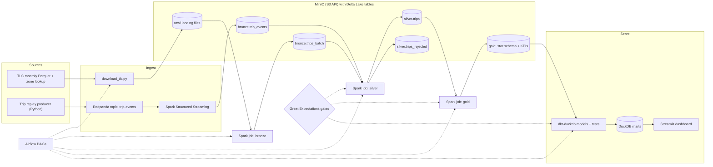

# TaxiStream Lakehouse

A lakehouse on public NYC taxi trip data that lands trips by batch and by stream, cleans them through bronze, silver and gold Delta tables, and serves tested dbt marts. It runs on one laptop for free.

**Status:** in development — design spec and build plan; results land as each phase ships.

          

---

## Why this exists

The NYC Taxi and Limousine Commission (TLC) publishes a Parquet file of yellow taxi trips every month, a few million rows each. The files are real data with real problems: negative fares, dropoffs before pickups, timestamps years outside the file's month, column types and casing that drift between months, and no trip ID to deduplicate on. Most data engineering demos stop at loading one clean file into one table. TaxiStream covers the part a data engineer actually owns: two kinds of ingestion (files and events), cleaning rules with a quarantine table, reruns that do not duplicate data, quality gates that stop bad data from moving forward, scheduled backfills, and tested models that a dashboard can trust. Everything runs in Docker Compose with no cloud account.

## What it does

- **Batch ingestion.** A download script pulls a chosen range of TLC yellow taxi months plus the taxi zone lookup and lands them in MinIO, an S3-compatible object store.
- **Streaming ingestion.** A Python producer replays trips as JSON events into Redpanda (Kafka API). A Spark Structured Streaming job writes them to a Delta bronze table with checkpoints, so a restart does not lose or duplicate a micro-batch.
- **Medallion layers in Delta Lake.** Bronze keeps raw rows plus ingestion metadata. Silver enforces one schema, builds a deterministic `trip_key`, deduplicates, and moves invalid rows to `silver.trips_rejected` with a reason code. Gold builds a star schema and KPI tables.
- **Idempotent writes.** Bronze uses partition overwrite (`replaceWhere`) per month. Silver and the gold fact table use Delta `MERGE` on `trip_key`, so rerunning a month gives the same result.
- **Quality gates.** Great Expectations suites run after bronze, silver and gold. A failed gate fails the Airflow task and nothing downstream runs for that month.
- **Orchestration with backfills.** An Airflow DAG runs one month per run with retries. Catchup and the backfill command reprocess any range of months.
- **dbt marts on DuckDB.** dbt-duckdb reads the gold tables, builds analytics marts, and runs schema and data tests. `dbt docs` documents lineage.
- **Small dashboard.** A Streamlit app shows trip KPIs from the marts and a pipeline health page (rows per layer, rejected percentage, streaming latency).

## Architecture



Trips enter two ways. The batch path downloads monthly TLC files to a raw landing area in MinIO, and a Spark job loads each month into `bronze.trips_batch`. The streaming path replays trips through Redpanda, and a long-running Structured Streaming query appends them to `bronze.trip_events`. A silver job reads both bronze tables, applies one schema and one set of cleaning rules, and merges valid rows into `silver.trips` while sending invalid rows to a rejected table. The gold job builds the star schema and KPI tables, and dbt-duckdb turns gold into tested marts for the dashboard. Airflow runs the batch steps in order, and a Great Expectations gate sits in front of each promotion, so a failed check stops the month where it is.

## How it works

### Storage: MinIO and Delta Lake

All tables live in one MinIO bucket and are read and written by Spark through the `s3a://` connector, the same path style used against AWS S3. That keeps the code cloud-ready without a cloud bill. Tables use Delta Lake for ACID commits, schema enforcement, `MERGE`, and time travel, which matters when a bad run has to be inspected or rolled back. Delta on S3-style storage is only safe for concurrent writers from a single Spark driver, so each table has exactly one writer job (see the bronze design below).

### Batch ingestion

`scripts/download_tlc.py` takes a month range (for example `2024-01..2024-03`), downloads the yellow taxi Parquet files and `taxi_zone_lookup.csv` from the [NYC TLC Trip Record Data](https://www.nyc.gov/site/tlc/about/tlc-trip-record-data.page) page, and uploads them to `raw/` in MinIO. Data is never committed to the repo. It skips files whose size and checksum have not changed, so a rerun is cheap. Raw files are never edited. They are the replay source if any later layer has to be rebuilt.

### Streaming ingestion

`producer/replay_trips.py` reads one TLC month and publishes each trip as a JSON event to the `trip-events` topic at a configurable rate. Each event carries `produced_at`, which later gives end-to-end latency. Events are keyed by pickup zone, so trips from one zone keep their order inside a partition. The default demo replays a month the batch path did not load, so the two sources do not overlap, but silver deduplicates either way.

The Structured Streaming job reads the topic with a 10-second processing-time trigger and `maxOffsetsPerTrigger` as a cap, parses the JSON against an explicit schema, adds `bronze_written_at`, and appends to `bronze.trip_events`. Offsets live in the query's checkpoint, and the Delta sink records each batch ID in its transaction log, so a replayed batch after a crash is skipped instead of written twice.

### Bronze layer

Bronze is append-only raw data plus metadata: `source` (`batch` or `stream`), `source_file` or Kafka offset, `ingested_at`, and `source_month`. The batch and stream paths write to two separate bronze tables on purpose. Two Spark drivers writing to one Delta table on S3-compatible storage can corrupt the log without an external lock service (DynamoDB in AWS), and splitting the tables removes that risk. The batch bronze job overwrites only its own month with `replaceWhere`, which makes reruns idempotent.

### Silver layer

The silver job is where the data gets trustworthy:

- **Schema enforcement.** Columns are renamed to one snake_case schema and cast to fixed types, since types and casing vary between TLC months.
- **Deterministic key.** TLC has no trip ID, so `trip_key` is a SHA-256 hash of vendor, pickup and dropoff timestamps, pickup and dropoff zones, distance, and total amount. Nulls are replaced with a sentinel before hashing so that different null patterns cannot collide.
- **Invalid-record filtering.** Rules live in a YAML file: dropoff not after pickup, trip longer than 6 hours, negative fare or total, distance not positive or above 200 miles, pickup outside the file's month, unknown zone ID. Failing rows go to `silver.trips_rejected` with every rule they broke.
- **Dedup and upsert.** Rows are deduplicated inside the batch first (Delta `MERGE` fails if two source rows match one target row), then merged into `silver.trips` on `trip_key`.

Batch months are processed by month. Stream events reach silver through an incremental read of `bronze.trip_events` (`availableNow` trigger with its own checkpoint), which processes only new bronze rows each run.

### Gold layer

Gold is a star schema at one-row-per-trip grain: `fact_trips` plus `dim_zone`, `dim_date`, `dim_vendor`, `dim_payment_type` and `dim_rate_code`. KPI tables are `agg_zone_hourly_demand`, `agg_daily_revenue` and `agg_tip_rate`. The fact table is merged on `trip_key`. KPI tables are rebuilt only for the dates that changed, using `replaceWhere`. Tip metrics are computed for card payments only, since TLC records cash tips as zero.

### Quality gates

Great Expectations suites run on the Spark DataFrame of each layer for the month being processed. Bronze checks row count against the source file and required columns. Silver checks key uniqueness, not-null keys, value ranges, and a ceiling on the rejected percentage. Gold checks referential integrity between the fact and dimensions and that daily revenue reconciles with silver. A failed suite raises, the Airflow task fails, and downstream tasks are skipped. The validation result is saved for inspection.

### Orchestration

`tlc_monthly_batch` is a monthly Airflow DAG. Each run uses its data interval start to pick the month, so the same DAG handles today's month and any backfill. Tasks: download, bronze, gate, silver, gate, gold, gate, `dbt build`. Download retries with a long delay because TLC publishes files with a lag. Spark tasks retry twice, and gate tasks do not retry, since rerunning a check on the same data gives the same answer. A second, hourly DAG moves new stream events from bronze to silver and refreshes gold for the affected dates. Every job writes rows in, rows out, rows rejected and runtime to `ops.run_metrics`.

### dbt models

dbt-duckdb reads gold Delta tables from MinIO through DuckDB's `delta` and `httpfs` extensions. Staging models rename and type-check sources. Marts (`mart_zone_demand`, `mart_daily_revenue`, `mart_payment_mix`) are what the dashboard reads. Tests cover `unique`, `not_null`, `relationships` and `accepted_values`, plus a few custom SQL tests such as "no negative revenue days". The DuckDB file is the serving layer: small, fast, and free.

### Dashboard

A Streamlit app with two pages. Trips shows trips, revenue, average fare and card tip rate for a date range, plus demand by zone and hour. Pipeline health shows rows per layer and rejected percentage per run from `ops.run_metrics`, and recent streaming latency. The UI follows the unslop rules: one neutral ramp and one accent, lucide icons, tabular numbers, sentence-case copy.

### CI

GitHub Actions runs ruff, pytest (unit tests on small fixtures with a local Spark session and Delta), an Airflow DAG import test, `dbt build` against fixture Parquet files, and `docker compose config`. On `main` it also builds the Docker images to catch broken Dockerfiles.

## Tech stack

| Layer | Tools | Why |
|---|---|---|
| Language | Python 3.11, uv, ruff, pytest | One language from ingestion to dashboard. uv gives fast, locked installs |
| Object storage | MinIO (S3 API) | Same `s3a://` code as AWS S3, free and local |
| Table format | Delta Lake 3.x | ACID, `MERGE`, schema enforcement, time travel, and a streaming sink that is idempotent per batch |
| Processing | PySpark 3.5 (standalone master + 1 worker) | Same API for batch and streaming, and the skill the role asks for |
| Event streaming | Redpanda, Spark Structured Streaming | Kafka API in one container with no JVM or ZooKeeper. Client code works unchanged on Kafka or MSK |
| Orchestration | Apache Airflow with Postgres metadata | Retries, data intervals, catchup and backfills. The most common orchestrator in job postings |
| Data quality | Great Expectations (GX Core), dbt tests | GX checks Spark DataFrames between layers. dbt tests check the marts |
| Modeling and serving | dbt-duckdb, DuckDB | Tested SQL models with lineage and docs, in-process and free |
| Dashboard | Streamlit | One Python file, no extra metadata database |
| Runtime and CI | Docker Compose (profiles), GitHub Actions | One command to start. Profiles keep laptop memory in check |

## Project structure

Planned layout. Folders appear as phases land.

```
taxistream-lakehouse/
├── docker-compose.yml          # MinIO, Postgres, Airflow, Spark, Redpanda, Streamlit
├── Makefile                    # make up, data, batch, stream, dbt, test, bench
├── .env.example
├── pyproject.toml
├── docker/
│   ├── airflow/Dockerfile      # Airflow + Java + pyspark + Spark provider
│   ├── spark/Dockerfile        # Spark 3.5 + Delta, hadoop-aws, Kafka jars
│   └── dashboard/Dockerfile
├── scripts/
│   └── download_tlc.py         # TLC months + zone lookup -> MinIO raw/
├── producer/
│   └── replay_trips.py         # TLC rows -> JSON events -> Redpanda
├── spark_jobs/
│   ├── common/                 # Spark session, schemas, config, run metrics
│   ├── batch/                  # bronze_ingest.py, silver_clean.py, gold_build.py
│   └── streaming/              # trip_events_to_bronze.py
├── quality/
│   ├── gx/                     # expectation suites per layer
│   ├── rules.yml               # silver rejection rules
│   └── run_gate.py
├── airflow/dags/               # tlc_monthly_batch.py, stream_to_silver.py
├── dbt/taxistream/                # staging, marts, tests, profiles.yml
├── dashboard/app.py            # Streamlit
├── notebooks/eda.ipynb
├── tests/                      # unit/, integration/, fixtures/
├── docs/
│   ├── results/                # raw benchmark output
│   └── screenshots/
└── .github/workflows/ci.yml
```

## Getting started

Target workflow, available once Phase 1 lands. Commands and ports may change while building.

**Prerequisites**

- Docker Desktop (or Docker Engine) with Compose v2 and at least 8 GB of memory given to Docker
- Python 3.11 and [uv](https://docs.astral.sh/uv/) for running tests outside containers
- `make` (on Windows, use WSL or Git Bash)
- A few GB of free disk for three months of TLC data

**Run it**

```bash
git clone https://github.com/striderzz/taxistream-lakehouse.git
cd taxistream-lakehouse
cp .env.example .env            # MinIO keys, Airflow admin, month range

make up                         # docker compose up -d (core + batch services)
make data MONTHS=2024-01..2024-03
make batch                      # trigger the Airflow DAG for those months
make stream                     # start Redpanda, the producer and the streaming job
make dbt                        # dbt build + dbt docs generate
```

Planned local URLs: Airflow on `localhost:8080`, MinIO console on `localhost:9001`, Spark master UI on `localhost:8081`, dashboard on `localhost:8501`.

**Run tests**

```bash
uv sync
make test                       # ruff + pytest + dbt build on fixtures
```

## Results

No results yet. Each value is filled from a real run, with raw output in `docs/results/` and the machine and Docker memory limits recorded next to it.

| Metric | Value | How it is measured |
|---|---|---|
| Rows processed per run (bronze, silver, gold) | — | Row counts each job writes to `ops.run_metrics` for one month. Measured after Phase 6; raw output in docs/results/ |
| Batch runtime per layer | — | Wall-clock start and end of each Spark job for one month and for a 3-month backfill, cross-checked with Airflow task duration. Measured after Phase 6; raw output in docs/results/ |
| Streaming throughput (events/sec) | — | `processedRowsPerSecond` from the streaming query progress, averaged over a 10-minute replay at fixed producer rates. Measured after Phase 7; raw output in docs/results/ |
| End-to-end latency to bronze (p50, p95) | — | `bronze_written_at - produced_at` per event over the same replay. Measured after Phase 7; raw output in docs/results/ |
| Records rejected by quality rules (%) | — | Rejected rows divided by bronze rows per month, with a breakdown by reason code. Measured after Phase 3; raw output in docs/results/ |

## Roadmap

- [ ] Phase 1: scaffold, Docker Compose stack (MinIO, Postgres, Airflow, Spark), Makefile, `.env.example`, CI skeleton
- [ ] Phase 2: TLC download script into MinIO, zone lookup, EDA notebook on dirty-data patterns
- [ ] Phase 3: bronze ingest and silver cleaning (schema, `trip_key`, dedup, rejected table, `MERGE`) with unit tests
- [ ] Phase 4: gold star schema and KPI tables
- [ ] Phase 5: Great Expectations gates for bronze, silver and gold
- [ ] Phase 6: Airflow DAG with retries, backfills and gates wired in
- [ ] Phase 7: streaming path (Redpanda, replay producer, Structured Streaming to bronze, incremental silver)
- [ ] Phase 8: dbt-duckdb models, tests and docs
- [ ] Phase 9: Streamlit dashboard with unslop pass and real screenshots
- [ ] Phase 10: benchmarks into `docs/results/`, Results table filled, demo GIF

## Stretch goals

- Snowflake as a second dbt target with the same models
- Terraform for a real S3 bucket and least-privilege IAM role, with a documented cloud run
- SCD Type 2 dbt snapshots for the zone dimension
- Data contracts for the event schema, checked in CI and by the producer
- Delta `OPTIMIZE` and Z-ordering with before and after query timings

## Related projects

- [FraudSight MLOps](https://github.com/striderzz/fraudsight-mlops) uses the same ideas on a different problem: a Kafka-API event stream, layered offline tables, and checks before data is used for features. No code is shared between the two repos.

## Author

Hasan · [GitHub](https://github.com/striderzz) · [LinkedIn](https://www.linkedin.com/in/hasan-m-4b1bba315) · [Portfolio](https://striderzz.github.io/portfolio-website)

## License

MIT
