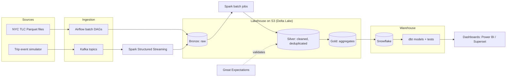

# Rapture – Lakestream Platform

**Real-time + batch data lakehouse for NYC ride-hailing analytics**

Kafka · Spark Structured Streaming · Delta Lake · Apache Airflow · dbt · Snowflake · Great Expectations · Terraform · AWS · Docker · GitHub Actions

> **Status: under active development.** This README is the design spec. The checklist in the [Roadmap](#roadmap) shows what is built so far.

---

## Overview

Rapture is an end-to-end data engineering platform built on public **NYC TLC trip records**, which cover millions of yellow taxi, green taxi and for-hire vehicle trips every month.

It combines two pipelines:

- **Streaming:** a Python producer replays trips as live events into **Apache Kafka**. **Spark Structured Streaming** consumes them and writes to **Delta Lake** with exactly-once semantics.
- **Batch:** **Apache Airflow** ingests the monthly Parquet files. Data moves through a **medallion architecture** (bronze → silver → gold), is modeled with **dbt** in **Snowflake**, and is checked with **Great Expectations**.

The gold layer feeds BI dashboards showing demand by zone, revenue, trip duration, tipping behaviour and near-real-time KPIs.

## Architecture



## Tech stack

| Layer | Tools |
|---|---|
| Streaming | Apache Kafka (Amazon MSK in the cloud), Spark Structured Streaming |
| Batch processing | Apache Spark (PySpark), Databricks-compatible notebooks |
| Storage | Amazon S3, Delta Lake (ACID tables, time travel, schema enforcement) |
| Orchestration | Apache Airflow (TaskFlow API, backfills, SLAs, retries) |
| Warehouse and modeling | Snowflake, dbt (staging → intermediate → marts, tests, docs) |
| Data quality | Great Expectations, dbt tests, row-count and freshness checks |
| Infrastructure as code | Terraform (S3, IAM, MSK, Snowflake objects) |
| DevOps | Docker Compose for local development, GitHub Actions CI/CD, pre-commit, PyTest |
| Observability | Airflow alerts, pipeline run metadata, data freshness monitoring |
| BI | Power BI / Apache Superset |

## Data model

The gold layer and dbt marts use a **star schema**:

- `fact_trips`: one row per trip (distance, duration, fare, tip, surcharges)
- `dim_zone`: TLC taxi zones and boroughs
- `dim_datetime`: hour, day, week and holiday flags
- `dim_vendor`, `dim_payment_type`, `dim_rate_code`
- Aggregates: `agg_zone_hourly_demand`, `agg_daily_revenue`, `agg_driver_kpis`

Slowly changing dimensions (**SCD Type 2**) are handled with dbt snapshots.

## Pipeline design

1. **Bronze (raw):** append-only ingestion of Parquet files and Kafka events, with ingestion metadata and the source file name.
2. **Silver (clean):** schema enforcement, type casting, deduplication on trip keys, removal of invalid records (negative fares, zero distance, impossible timestamps) and zone enrichment.
3. **Gold (business):** star-schema facts and dimensions plus aggregated KPI tables.
4. **Warehouse:** gold tables load into Snowflake, where dbt builds the analytics marts and runs tests.
5. **Quality gates:** Great Expectations suites run between layers. A failed check stops promotion to the next layer.
6. **Incremental processing:** watermarking and Delta `MERGE` for upserts and late-arriving data.

## Planned repository structure

```
rapture-lakestream-platform/
├── infra/terraform/          # AWS + Snowflake infrastructure as code
├── docker/                   # docker-compose: Kafka, Spark, Airflow, Postgres
├── producers/                # Kafka trip-event simulator
├── spark/
│   ├── streaming/            # Structured Streaming jobs (Kafka -> Delta bronze)
│   └── batch/                # bronze -> silver -> gold jobs
├── airflow/dags/             # orchestration DAGs
├── dbt/                      # dbt project: staging, marts, snapshots, tests
├── great_expectations/       # data quality suites
├── tests/                    # PyTest unit + integration tests
└── .github/workflows/        # CI: lint, test, dbt build
```

## Roadmap

- [ ] Docker Compose environment (Kafka, Spark, Airflow, Postgres)
- [ ] Kafka trip-event producer
- [ ] Spark Structured Streaming: Kafka to Delta bronze
- [ ] Airflow batch ingestion of TLC Parquet files
- [ ] Silver cleaning and deduplication jobs
- [ ] Gold star schema and KPI aggregates
- [ ] dbt project on Snowflake with tests and snapshots
- [ ] Great Expectations quality gates
- [ ] Terraform for AWS (S3, IAM, MSK) and Snowflake
- [ ] GitHub Actions CI/CD
- [ ] Dashboard and performance benchmarks (rows/sec, end-to-end latency, cost)

## Data source

NYC Taxi & Limousine Commission (TLC) Trip Record Data, which is publicly available from the NYC TLC website.

## Author

**Hasan Mohd Hussain**: [GitHub](https://github.com/striderzz) · [LinkedIn](https://www.linkedin.com/in/hasan-m-4b1bba315/) · [Portfolio](https://striderzz.github.io/portfolio-website/)
